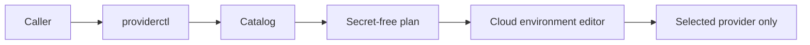

# Provider catalog design

## Usage

```bash
node cloud-body/providers/providerctl.mjs list
node cloud-body/providers/providerctl.mjs show deepseek
node cloud-body/providers/providerctl.mjs plan deepseek
```

`plan` returns JSON for an environment editor. It does not write configuration
or read secret values.

## Chosen shape

`catalog.json` owns cloud deployment metadata. Each profile has one provider
mode, one cloud policy, settings, an optional secret variable, and at most one
exact credential hostname. `providerctl.mjs` owns parsing and command behavior.
The test owns drift detection against claude-mem's preset registry.

Provider selection and role selection are separate decisions. The logical
identity belongs to task state, memory, permissions, and accepted commits. A
session may hold a temporary coordinator lease, but no provider is the
permanent head.



## Role allocation

| Role | Selection policy |
| --- | --- |
| Coordinator | Current interactive session with planning and tool access; its lease ends at handoff or completion |
| Builder | Tool-capable coding session with bounded repository write authority |
| Researcher | Read-only session chosen for search and context needs |
| Observer | Low-latency model that returns the required structured observation format |
| Reviewer | Independent session or provider that did not produce the change |
| Private executor | Custom endpoint whose hostname and credential scope satisfy the data policy |

The coordinator may also build a small change, but it cannot count its own
implementation as independent review. A provider outage changes the selected
body, not the task identity.

## Profile states

- `cloud-ready`: the endpoint and exact hostname are known.
- `requires-endpoint`: the user must supply a custom HTTPS endpoint first.
- `local-only`: the profile points at localhost and cannot be planned for this
  cloud body.

These values make invalid cloud plans explicit. Optional fields do not decide
policy by accident.

## Alternatives considered

Continuing to add commented variables to `.env.example` was rejected. It has no
machine-readable coverage or drift check. Adding vendor adapters to claude-mem
was also rejected because the application already has a generic compatible
provider and the request keeps the original body unchanged.

A fixed table that permanently assigns one provider to each role was rejected.
Provider quality, quota, and tool availability change. The router matches the
current task requirements to an eligible profile and keeps the role contract
stable.

## Security boundary

One plan scopes one credential variable to one exact hostname. The catalog does
not emit wildcard hosts, secret values, query-string tokens, or a combined
allowlist for every provider.
